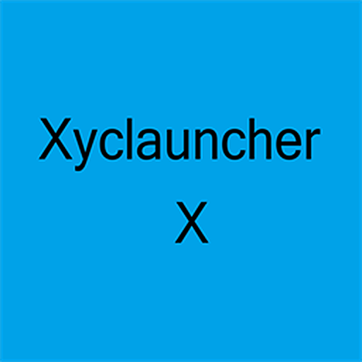

  

<h1 align="center">xyc Launcher</h1>

  
  
  
  

<b>156 KB，一秒下完</b> —— GitHub 再慢也拦不住，双击即用，Java 自动配

一个极简的《我的世界》启动器：安装包只有 **0.15 MB**（HMCL 的 1/64），不捆 Java、不捆依赖，第一次打开自己去配需要的运行时。

## 下载

| 版本 | 体积 | 下载 |
|---|---|---|
| 64 位（推荐） | 156 KB | [xyc.Launcher.exe](https://github.com/xyc-launcher/Launcher/releases/download/Launcher/xyc.Launcher.exe) |
| 32 位 | 156 KB | [xyc.Launcher.32bit.exe](https://github.com/xyc-launcher/Launcher/releases/download/Launcher/xyc.Launcher.32bit.exe) |

- **系统**：Windows + .NET Framework 4.x（Win10 / Win11 自带，无需另装）
- **Java**：不用手动装。启动器会依次在 `JAVA_HOME`、注册表、`.minecraft\runtime`、
  `PATH` 里找，找不到就自动下载对应版本并解压
- **配置**：双击即开，设置写在 exe 同目录的 `config.json`

## 功能

- **账号**
  - 同一局域网内多台设备之间可以 P2P 分发文件，下载支持多线程与多点并发
  - 离线模式：输入任意名字，生成离线账号（单机/局域网/部分服务器）。
  - 微软正版登录：设备码全链路（OAuth → Xbox Live → XSTS → Minecraft → 玩家档案），
    自动保存 refreshToken，令牌过期自动刷新。
  - 皮肤站外置登录：填写 Yggdrasil API（默认 LittleSkin）+ 账号密码即可；
    启动时自动下载并注入 authlib-injector，支持 LittleSkin、Blessing Skin 等兼容站点。
- **游戏版本下载**
  - 「刷新版本列表」拉取全部版本（release / snapshot / old_beta / old_alpha）。
  - 启动时自动下载：版本 JSON、客户端 jar、全部库文件（含 native 解压）、资源文件。
  - 下载默认走 BMCLAPI 国内镜像，官方源→镜像逐文件回退；断点续传 + 8 轮重试 + 403 指数退避，
    客户端大文件慢网也能下完；最终按 sha1 校验，不符自动重下。
- **mod 加载器下载**（「Mod 加载器」分页）
  - 支持 **Fabric / Quilt / Forge / NeoForge**：选择加载器版本后启动时自动下载加载器库
    并生成启动 profile；Forge / NeoForge 会自动下载官方 installer 并静默安装。
- **整合包下载**（「整合包」分页）
  - 搜索 Modrinth 整合包（.mrpack），下载并解析索引，自动把 mods 与覆盖文件部署到
    `.minecraft\instances\<包名>\` 独立实例目录，按整合包要求自动装对应 MC 版本与加载器。
- **Java 自动检测与自动下载**
  - 启动时读取版本 JSON 的 javaVersion 要求；本机有可用的 Java 则直接用，
    否则自动下载微软 OpenJDK（aka.ms 官方直链，国内可达、支持断点续传）并解压。
  - 「Java」下拉默认「自动：按游戏版本要求（推荐）」——按版本 JSON 的 javaVersion 选最合适的运行时，
    没有就下载；也可选「自动：使用最新版」「固定 Java 17」「固定 Java 21」。
- **启动参数完整支持**
  - 完整解析版本 JSON 的 `arguments.jvm`（`--enable-native-access`、`--add-exports`、
    `-Djava.library.path`、`-cp` 等 Java 25 必需项）与 `arguments.game`；
  - 按规则（os/arch/features）精确启用参数：自定义分辨率自动传入宽高，
    quick play / demo 等未启用功能参数不会被误传，杜绝「Only one quick play option」类崩溃。
- **文件完整性校验**
  - 「校验文件完整性」按钮：按版本 JSON 的 sha1 逐文件核对客户端 jar、全部库与资源，
    缺失/损坏文件自动补下并返回修复数量。
- **设置**
  - 内存：512MB ~ 16GB；下载源：bmclapi 国内镜像 / mojang 官方；
    窗口 960×640（可在源码 Config 调整）。

## 已知说明

- 微软正版登录需在浏览器输入设备码完成授权；若提示「未获取到 Minecraft 资料」，
  说明该微软账号未购买 Java 版（可先用离线模式）。
- P2P 分发（局域网多设备互传）这部分没有放进仓库，Release 里的 exe 才是带 P2P 的完整版。
  自己编译仓库源码得到的版本会少这一块，属于预期行为，不是编译出错。

## 许可

本项目以 **MIT License** 发布，完整条款见 [LICENSE](LICENSE)。

Copyright (C) 2026 xycwww2025

- 可以自由使用、修改、再分发，包括商业用途，也可闭源使用
- 只需要保留版权声明和许可声明
- 不提供任何担保

